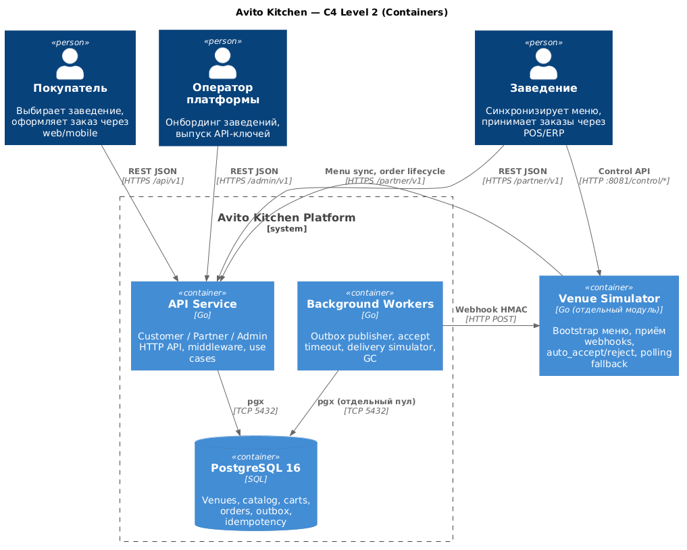
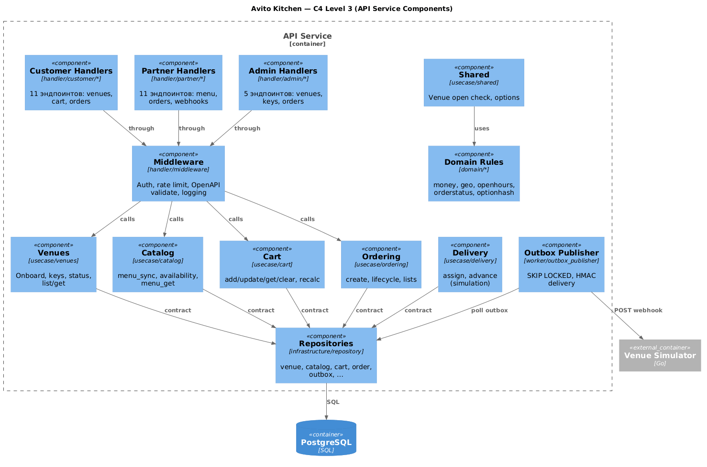
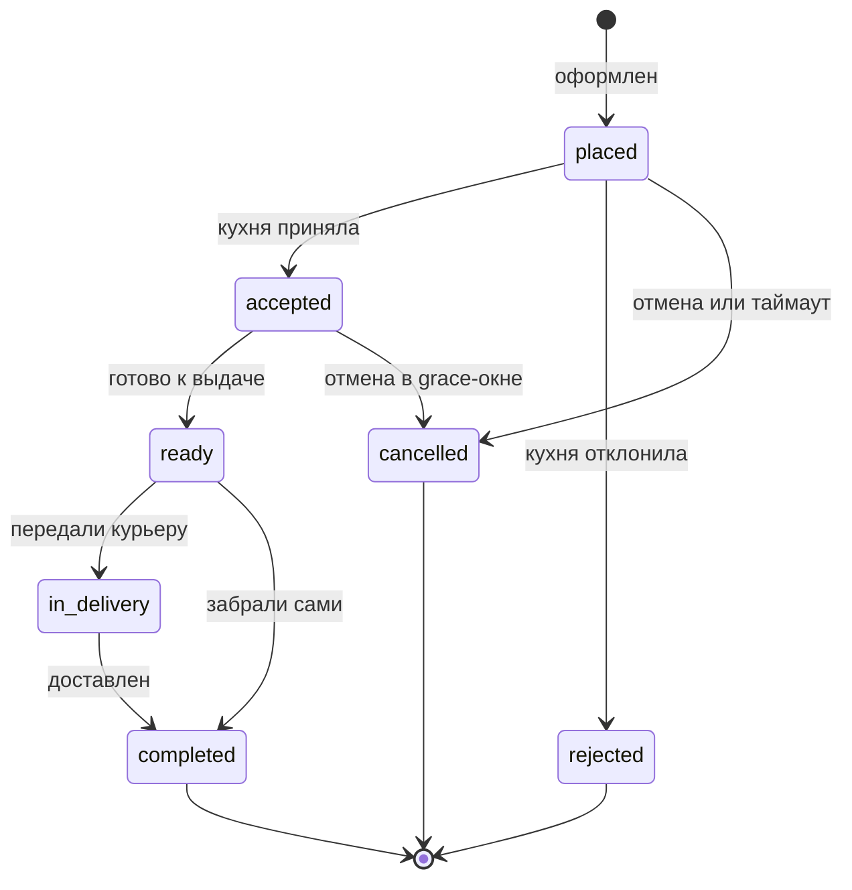
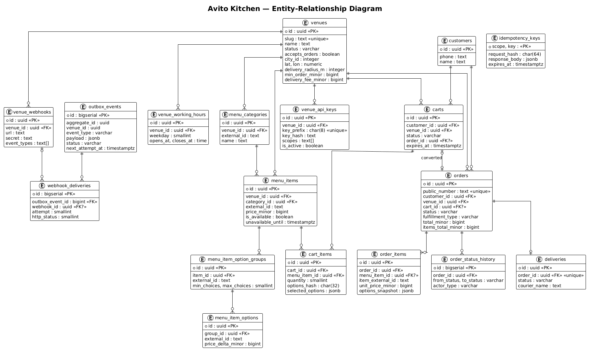
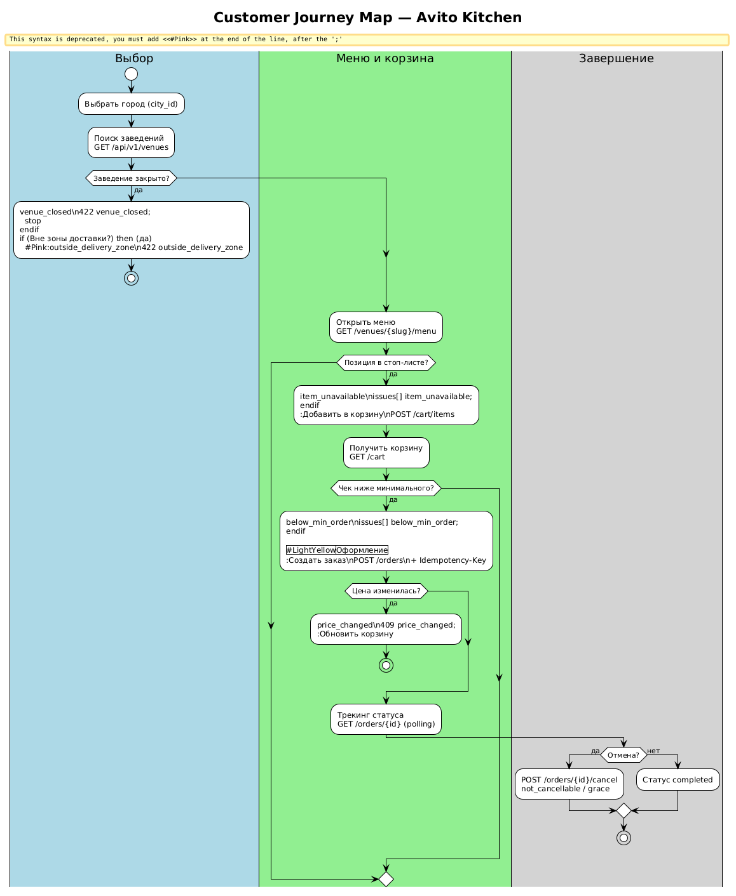
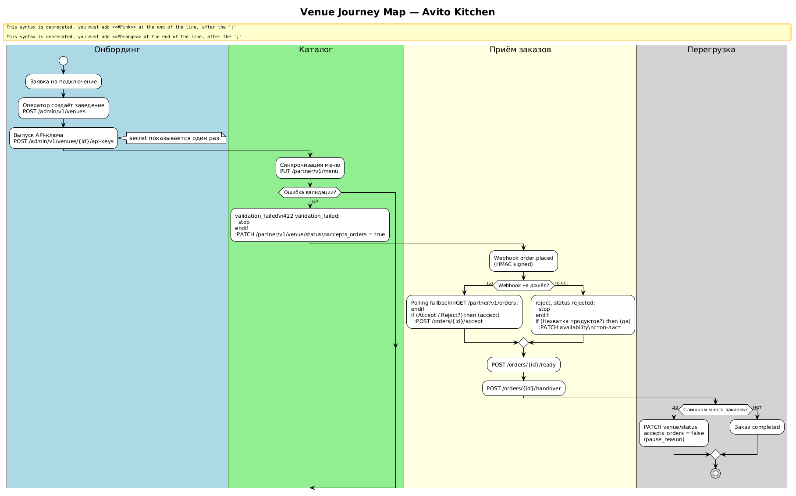
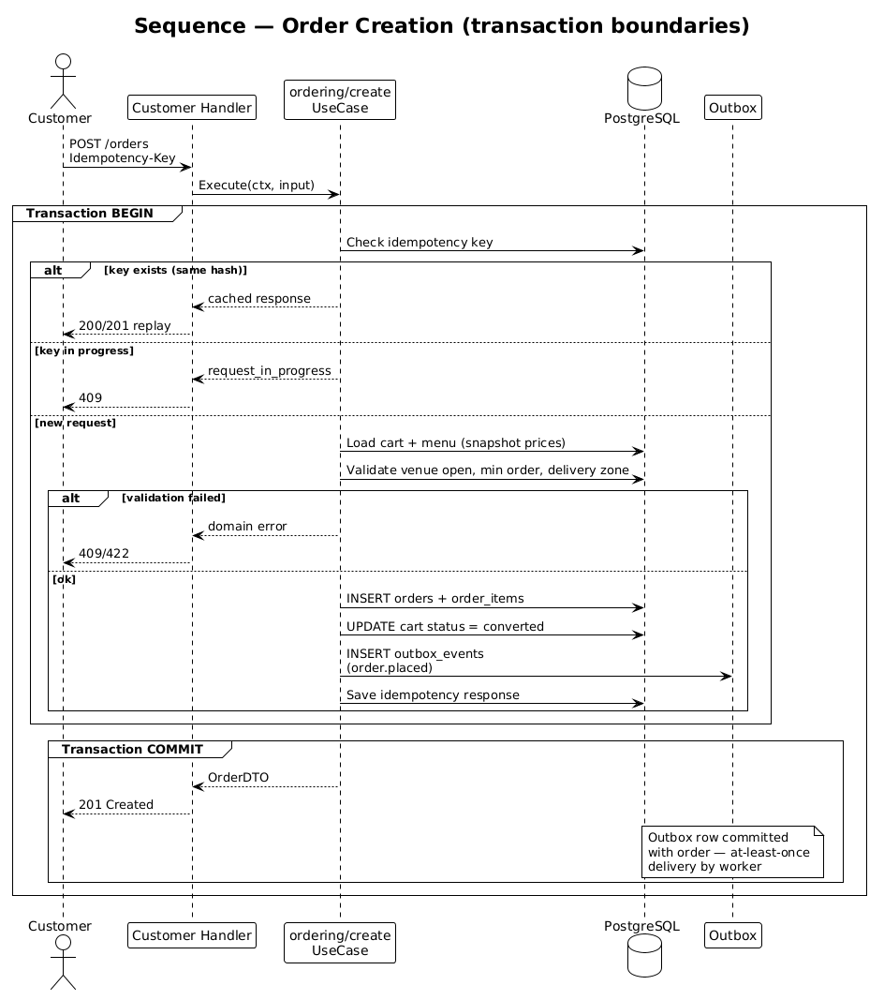
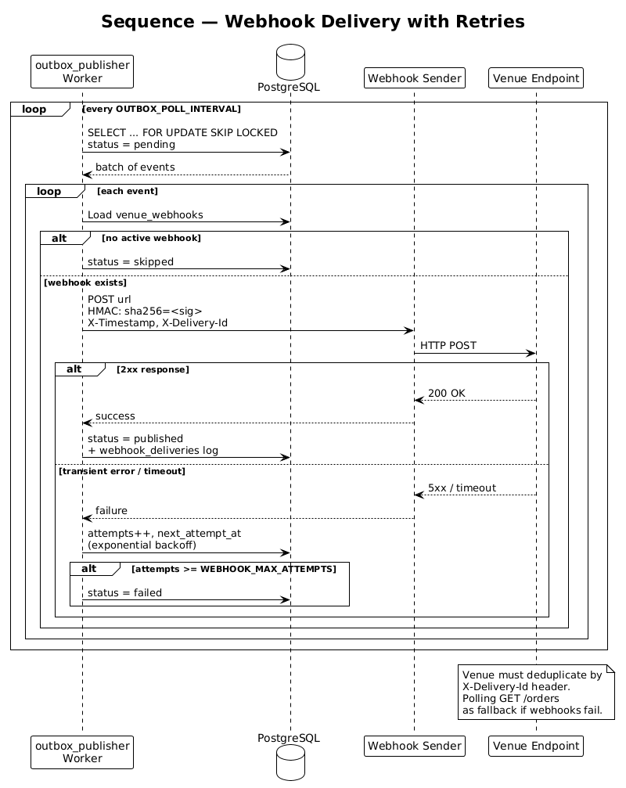

# Avito Kitchen

[](https://github.com/talense-tasks/backend-trainee-assignment-autumn-2026-flow-2-zlatovlaska707-5c42a219/actions/workflows/ci.yml)

MVP бэкенда «Авито.Кухня» — площадки, через которую покупатель находит заведение и оформляет доставку, а ресторан принимает заказ из своей кассовой системы. Это один Go-сервис с тремя HTTP API, PostgreSQL, фоновыми воркерами и отдельным симулятором заведения. Весь стек поднимается одной командой Docker Compose.

## Содержание

- [О проекте](#о-проекте)
- [Быстрый старт](#быстрый-старт)
- [API](#api)
- [Архитектура](#архитектура)
- [Схема базы данных](#схема-базы-данных)
- [Сценарии и диаграммы](#сценарии-и-диаграммы)
- [Интеграция заведения](#интеграция-заведения)
- [Конфигурация](#конфигурация)
- [Запуск](#запуск)
- [Команды Makefile](#команды-makefile)
- [Тестирование](#тестирование)
- [Принятые упрощения](#принятые-упрощения)
- [Что можно развивать дальше](#что-можно-развивать-дальше)
- [Документация](#документация)

## О проекте

Платформа стоит между двумя сторонами:

- **покупатель** выбирает город, смотрит меню, собирает корзину и оформляет заказ;
- **заведение** публикует меню, ведёт стоп-лист, принимает или отклоняет заказ и проводит его по кухне.

Клиентскую часть и авторизацию пользователей ТЗ прямо выводит за скобки. Поэтому покупатель в MVP идентифицируется заголовком `X-Customer-Id`, а «закрытый доступ» заведений сделан через API-ключи, которые выдаёт оператор платформы.

Деньги везде в копейках (`*_minor`), время — UTC, идентификаторы — UUID. Меню заведения живёт в своих `external_id`, платформа мапит их на внутренние ID. Заказ хранит снимок состава и цен: позже меню может измениться, а чек уже зафиксирован.

### Как это устроено внутри (коротко)

Основной сервис — **модульный монолит**. Один процесс обслуживает Customer / Partner / Admin API и фоновые задачи. Заведение-симулятор — отдельный бинарь в том же репозитории: так требует задание, и так проще показать двустороннюю интеграцию.

Слои жёстко разделены: HTTP-хендлер только разбирает запрос, сценарий живёт в `usecase`, доступ к таблицам — за контрактом репозитория. Общие правила (деньги, гео, часы работы, переходы статуса заказа) вынесены в `domain/` и покрыты юнит-тестами.

Главная транзакция — создание заказа. В одном `COMMIT` сервис перечитывает корзину и актуальные цены, проверяет зону и часы работы, пишет заказ со снимком, помечает корзину `converted` и кладёт событие в outbox. Вебхук уходит уже после коммита: так заведение не узнает о заказе, которого нет в базе.

Почему не микросервисы — в [ADR](#документация).

## Быстрый старт

Потребуются Docker и Docker Compose. Из корня репозитория:

```bash
docker compose up -d --build --wait
```

После запуска проверьте:

```bash
curl -fsS http://localhost:8080/health/live
curl -fsS "http://localhost:8080/api/v1/venues?city_id=1"
```

Swagger UI: http://localhost:8080/swagger

Спецификация: [`api/openapi.yaml`](api/openapi.yaml).

### Демо-данные из сида

| Что | Значение |
|---|---|
| Покупатель | `11111111-1111-1111-1111-111111111111` |
| Заведение Mario Pizza | slug `pizza-mario`, id `11111111-1111-4111-8111-111111111101` |
| Partner API key | `ak_demopizz_xK9mN2pQ7vR4wL8hT3jF6sD1aB0cE5gY9uI2oP4` |
| Admin token | `local-admin-token-change-me` |
| Позиция меню | Margherita `33333333-3333-4333-8333-333333333301` |
| Опция размера Medium | `66666666-6666-4666-8666-666666666302` |

В сиде ещё два заведения: `sushi-tokyo` (обычный график) и `burger-closed` (закрыто в рабочие часы - сценарий `venue_closed`).

Ключи и токены ниже — только для локальной разработки.

```bash
export CUSTOMER_ID=11111111-1111-1111-1111-111111111111
export PARTNER_API_KEY=ak_demopizz_xK9mN2pQ7vR4wL8hT3jF6sD1aB0cE5gY9uI2oP4
export ADMIN_TOKEN=local-admin-token-change-me
export VENUE_ID=11111111-1111-4111-8111-111111111101
export MENU_ITEM_ID=33333333-3333-4333-8333-333333333301
export SIZE_MEDIUM=66666666-6666-4666-8666-666666666302
```

### Сквозной сценарий (curl)

Симулятор заведения в Compose работает в режиме `auto_accept`: заказ сам дойдёт до `completed` (кухня + симуляция курьера).

```bash
# 1. Меню
curl -fsS "http://localhost:8080/api/v1/venues/pizza-mario/menu"

# 2. Две пиццы Medium в корзину
curl -fsS -X POST http://localhost:8080/api/v1/cart/items \
  -H "X-Customer-Id: $CUSTOMER_ID" \
  -H "Content-Type: application/json" \
  -d "{\"venue_id\":\"$VENUE_ID\",\"menu_item_id\":\"$MENU_ITEM_ID\",\"quantity\":2,\"option_ids\":[\"$SIZE_MEDIUM\"]}"

# 3. Корзина: запомните total_minor (для двух Medium + доставка это 137900)
curl -fsS http://localhost:8080/api/v1/cart -H "X-Customer-Id: $CUSTOMER_ID"

# 4. Заказ. expected_total_minor должен совпасть с корзиной, иначе 409 price_changed
curl -fsS -X POST http://localhost:8080/api/v1/orders \
  -H "X-Customer-Id: $CUSTOMER_ID" \
  -H "Idempotency-Key: demo-order-001" \
  -H "Content-Type: application/json" \
  -d '{"fulfillment_type":"delivery","address":{"text":"Tverskaya 10","lat":55.76,"lon":37.62},"contact_phone":"+79001234567","payment_method":"cash","expected_total_minor":137900}'

# 5. Статус заказа (подставьте id)
curl -fsS "http://localhost:8080/api/v1/orders/<order_id>" -H "X-Customer-Id: $CUSTOMER_ID"
```

Повтор того же `POST /orders` с тем же `Idempotency-Key` и тем же телом вернёт уже созданный заказ, а не второй.

## API

Контракт — OpenAPI 3.1. На запросах по умолчанию работает runtime-валидация (`OPENAPI_VALIDATE_REQUESTS`). Типы для сервера и HTTP-клиент симулятора генерируются из спеки; роутинг остаётся ручным, по одному пакету на операцию.

### Surfaces API

| Префикс | Кто | Как пускаем | Эндпоинтов |
|---|---|---|---|
| `/api/v1` | Покупатель / web | `X-Customer-Id` на корзине и заказах | 11 |
| `/partner/v1` | Заведение | `Authorization: Bearer <api_key>` + scopes | 11 |
| `/admin/v1` | Оператор | `Authorization: Bearer <ADMIN_API_TOKEN>` | 5 |
| системные | Оркестратор / мониторинг | Без авторизации | health, metrics, swagger |

Каталог (`GET /venues`, меню) публичный: заголовок покупателя не нужен. Корзина и заказы без `X-Customer-Id` не работают — это идентификация.

Scopes партнёрского ключа: `menu:write` (меню, стоп-лист, статус заведения) и `orders:write` (очередь и команды по заказу).

### Customer API

| Метод | Путь | Назначение |
|---|---|---|
| `GET` | `/api/v1/venues` | Список активных заведений города. Фильтры: `city_id`, координаты, `q`, `only_open`, сортировка, курсор |
| `GET` | `/api/v1/venues/{id}` | Карточка заведения и часы работы. `{id}` — UUID или slug |
| `GET` | `/api/v1/venues/{id}/menu` | Дерево меню. Есть ETag / `304 Not Modified` |
| `GET` | `/api/v1/cart` | Активная корзина с пересчётом цен и `issues[]` |
| `POST` | `/api/v1/cart/items` | Добавить позицию |
| `PATCH` | `/api/v1/cart/items/{itemId}` | Изменить количество |
| `DELETE` | `/api/v1/cart` | Очистить корзину |
| `POST` | `/api/v1/orders` | Оформить заказ из корзины (`Idempotency-Key`) |
| `GET` | `/api/v1/orders` | Лента заказов покупателя |
| `GET` | `/api/v1/orders/{orderId}` | Детали и таймлайн статусов |
| `POST` | `/api/v1/orders/{orderId}/cancel` | Отмена. После accept — только в окне `ORDER_CANCEL_GRACE` |

### Partner API

| Метод | Путь | Scope | Назначение |
|---|---|---|---|
| `PUT` | `/partner/v1/menu` | `menu:write` | Полная идемпотентная синхронизация меню по `external_id` |
| `PATCH` | `/partner/v1/menu/items/{externalId}/availability` | `menu:write` | Стоп-лист |
| `PATCH` | `/partner/v1/venue/status` | `menu:write` | Пауза/возобновление приёма (`accepts_orders`) |
| `GET` | `/partner/v1/orders` | `orders:write` | Очередь заведения, в том числе fallback-поллинг |
| `GET` | `/partner/v1/orders/{orderId}` | `orders:write` | Карточка заказа |
| `POST` | `/partner/v1/orders/{orderId}/accept` | `orders:write` | Принять |
| `POST` | `/partner/v1/orders/{orderId}/reject` | `orders:write` | Отклонить (нужна причина) |
| `POST` | `/partner/v1/orders/{orderId}/ready` | `orders:write` | Готово к выдаче |
| `POST` | `/partner/v1/orders/{orderId}/handover` | `orders:write` | Передать курьеру или закрыть самовывоз |
| `POST` | `/partner/v1/webhooks` | `orders:write` | Зарегистрировать URL для событий |
| `DELETE` | `/partner/v1/webhooks/{webhookId}` | `orders:write` | Снять регистрацию |

Чужой заказ для партнёра выглядит как `404`: не подтверждаем существование объектов другого тенанта.

### Admin API

| Метод | Путь | Назначение |
|---|---|---|
| `POST` | `/admin/v1/venues` | Создать заведение в статусе draft |
| `PATCH` | `/admin/v1/venues/{venueId}` | Профиль и модерация (`draft` → `active`) |
| `POST` | `/admin/v1/venues/{venueId}/api-keys` | Выпустить ключ. Secret показывается **один раз** |
| `DELETE` | `/admin/v1/venues/{venueId}/api-keys/{keyId}` | Отозвать ключ |
| `GET` | `/admin/v1/orders` | Кросс-тенантная лента для разбора инцидентов |

### Система

| Метод | Путь | Назначение |
|---|---|---|
| `GET` | `/health/live` | Процесс жив |
| `GET` | `/health/ready` | Готовность, в том числе проверка PostgreSQL |
| `GET` | `/metrics` | Prometheus |
| `GET` | `/swagger` | Swagger UI |

### Ошибки

Все бизнес-ответы одного вида:

```json
{
  "error": {
    "code": "venue_closed",
    "message": "Venue is closed",
    "details": {}
  }
}
```

| HTTP | `code` | Когда |
|---|---|---|
| 400 | `validation_failed`, `invalid_customer_id` | Невалидное тело, параметры или UUID покупателя |
| 401 | `unauthorized` | Нет или неверный ключ / админ-токен |
| 403 | `forbidden` | Не хватает scope или заказ чужого покупателя |
| 404 | `venue_not_found`, `order_not_found`, `cart_not_found`, `menu_item_not_found` | Ресурс не найден |
| 409 | `price_changed`, `item_unavailable`, `cart_venue_mismatch`, `invalid_transition`, `idempotency_key_reuse`, `request_in_progress`, `webhook_already_exists`, `venue_slug_taken` | Конфликт состояния |
| 413 | `payload_too_large` | Тело больше лимита |
| 422 | `venue_closed`, `below_min_order`, `outside_delivery_zone`, `cart_empty`, `not_cancellable`, `menu_sync_in_progress` | Бизнес-ограничение |
| 429 | `rate_limited` | Слишком часто |
| 500 | `internal_error` | Необработанная ошибка |
| 503 | `service_unavailable` | Нет базы |

В корзине отдельно приходит `issues[]`: `item_removed`, `item_unavailable`, `price_changed`, `option_unavailable`, `venue_closed`, `below_min_order`. Это не обязательно ломает `GET /cart` — клиент видит, что именно устарело, и может поправить состав до checkout.

## Архитектура

### Стек

| Слой | Выбор |
|---|---|
| Язык | Go 1.25 |
| HTTP | chi, middleware (request-id, timeout, recover, rate limit, OpenAPI validate) |
| Контракт API | OpenAPI 3.1, Spectral, oapi-codegen (типы + клиент симулятора) |
| БД | PostgreSQL 16, pgx, goose-миграции, Squirrel |
| Транзакции | [go-transaction-manager](https://github.com/avito-tech/go-transaction-manager) — общий `tx` в context |
| Конфиг | YAML + env через cleanenv. Секреты только в окружении |
| Наблюдаемость | slog JSON, Prometheus `/metrics` |
| Качество | golangci-lint, gofumpt, race-детектор, testcontainers |
| Запуск | Docker Compose: postgres, migrator, api, venue-simulator |

### Почему один сервис

Checkout должен быть атомарным: стоп-лист, снимок цен, заказ, инвалидация корзины и outbox. В монолите это одна транзакция PostgreSQL. На объёме «десятки заведений» распил на микросервисы добавил бы сетевые вызовы, саги и сложность деплоя без серьезного выигрыша.

Модульность всё равно есть. Пакеты `venues`, `catalog`, `cart`, `ordering`, `delivery` владеют своими таблицами и ходят друг к другу через контракты, а не через чужой SQL. Это готовые швы, если каталог или доставку вебхуков когда-нибудь (никогдаXD) вынесут отдельно. Подробнее — [ADR-0001](docs/decisions/ADR-0001-modular-monolith.md) и [ADR-0002](docs/decisions/ADR-0002-module-boundaries-order-tx.md).

Фоновые воркеры крутятся в том же процессе, но ходят в БД отдельным пулом, чтобы GC и ретраи вебхуков не отбирали соединения у пользовательских запросов. Несколько реплик API в таком виде воркеры бы дублировали — для MVP одна реплика.

### C4 Level 2 — контейнеры

C4 Level 2 показывает контейнеры. На диаграмме видны все запущенные процессы и их взаимодействия.



Исходник: [`docs/architecture/c4-l2.puml`](docs/architecture/c4-l2.puml)

Три действующих лица и два deployable-модуля. API Service принимает все HTTP-запросы. Воркеры в том же бинаре читают outbox, снимают просроченные `placed`-заказы, двигают симуляцию курьера и чистят протухшие корзины. PostgreSQL — единственное хранилище. Venue Simulator снаружи выглядит как POS заведения: пушит меню, принимает вебхуки, при сбое переходит на поллинг.

### C4 Level 3 — компоненты API

C4 Level 3 показывает компоненты. На диаграмме видны внутренности процесса API: кто принимает HTTP-запросы, где находится бизнес-логика и как данные попадают в Postgres — слои не перемешаны.



Исходник: [`docs/architecture/c4-l3.puml`](docs/architecture/c4-l3.puml)

Запрос идёт так: middleware → handler → usecase → контракт репозитория → PostgreSQL. Слои не протекают (как кошка в период течки): handler не лезет в SQL, usecase — в HTTP. Доменные инварианты (можно ли перейти `placed` → `accepted`, открыто ли заведение в его таймзоне) проверяются в `internal/domain`.

### Структура репозитория

```
cmd/api                  точка входа HTTP-сервиса
cmd/migrator             goose up/down + seed
internal/app             composition root: DI, роуты, воркеры
internal/config          YAML + env
internal/domain          правила без I/O: money, geo, openhours, orderstatus, optionhash
internal/handler         пакет на эндпоинт (customer / partner / admin)
internal/usecase         пакет на сценарий; контракты репозиториев рядом
internal/infrastructure  pgx-репозитории, вебхуки, воркеры
api/openapi.yaml         source of truth по HTTP
migrations/              миграции, схема 00001–00006 и идемпотентный seed
venue-simulator/         отдельный Go-модуль «заведение»
test/                    integration, contract, e2e, k6
docs/                    C4, CJM, ER, sequence, ADR, отчёт по нагрузке
```

Хендлер и usecase намеренно разбиты «фича = пакет»: `handler/customer/cart_item_add`, `usecase/ordering/create`. Из‑за этого серверный `ServerInterface` на все операции не генерируется — получился бы god-object. Генерируются типы и клиент симулятора. Соответствие спеке ловят middleware и контрактные тесты. Это [ADR-0003](docs/decisions/ADR-0003-partial-openapi-codegen.md).

### Воркеры

| Воркер | Зачем |
|---|---|
| `outbox_publisher` | Забирает `pending` события (`SKIP LOCKED`), шлёт HMAC-вебхук, пишет лог доставок, backoff |
| `accept_timeout` | Непринятый `placed` через `ORDER_ACCEPT_TIMEOUT` → `cancelled` системой |
| `delivery_simulator` | После handover: курьер назначен → в пути → доставлен |
| `stoplist_restore` | Снимает позицию со стоп-листа после `unavailable_until` |
| `cart_gc` | Удаляет протухшие активные корзины |
| `idempotency_gc` | Чистит ключи старше `IDEMPOTENCY_TTL` |

### Симулятор заведения

Отдельный сервис на `:8081`. При старте синкает `menu.json` в Partner API и подписывается на вебхуки. Режимы (переключаются с Control API, ими пользуются E2E):

| Режим | Поведение |
|---|---|
| `auto_accept` | Принять → «готовить» → ready → handover |
| `auto_reject` | Сразу отклонить с причиной |
| `silent` | Молчать: срабатывает accept_timeout платформы |
| `broken_webhook` | Ломать приём вебхуков — симулятор уходит в поллинг очереди |

Это как раз «пример одного заведения» из задания: другой процесс, другой порт, общение только по публичному Partner API.

### Жизненный цикл заказа

Заказ всегда начинается со статуса `placed`. Дальше кухня либо принимает его, либо отклоняет; покупатель может отменить, пока заказ ещё не ушёл в готовку (после `accepted` — только в коротком grace-окне). С `ready` пути расходятся: доставка идёт через `in_delivery`, самовывоз сразу закрывается.



Правила переходов живут в `internal/domain/orderstatus`. Нелегальный шаг с Partner API даёт `409 invalid_transition`. Конечные статусы: `completed`, `cancelled`, `rejected`.

## Схема базы данных

На схеме БД видно, какие таблицы отвечают за заведения, меню, корзину, заказы и интеграцию. Ниже — визуализация и пояснения по группам.



Исходник: [`docs/db/schema.puml`](docs/db/schema.puml)

Миграции лежат в `migrations/` (goose). Сид идемпотентный: повторный `seed` не плодит дубликаты.

| Группа | Таблицы | За что отвечают |
|---|---|---|
| Заведения | `venues`, `venue_working_hours`, `venue_api_keys`, `venue_webhooks` | Профиль, график, ключи, URL вебхуков |
| Каталог | `menu_categories`, `menu_items`, `menu_item_option_groups`, `menu_item_options` | Меню, модификаторы, стоп-лист, `external_id` |
| Покупатель и корзина | `customers`, `carts`, `cart_items` | Лениво созданный покупатель, одна активная корзина, `options_hash` |
| Заказы | `orders`, `order_items`, `order_status_history` | Снимок цен, машина состояний, история |
| Интеграция | `idempotency_keys`, `outbox_events`, `webhook_deliveries`, `deliveries` | Повтор checkout, outbox, лог вебхуков, симуляция курьера |

Инвариант «одна активная корзина» держит partial unique index, а не только код. Цены в заказе копируются в `order_items`: смена меню завтра не переписывает вчерашний чек.

| Индекс | Запрос, который он кормит |
|---|---|
| `venues_city_active_idx` | Список заведений города |
| `venues_geo_idx` | Bounding box + сортировка по haversine |
| `mi_venue_sellable_idx` | Меню: только продаваемые позиции |
| `mi_name_trgm_idx` | Поиск по названию (`pg_trgm`) |
| `carts_one_active_per_customer_idx` | Одна активная корзина на покупателя |
| `orders_venue_queue_idx` | Очередь партнёра |
| `orders_customer_feed_idx` | Лента покупателя |
| `orders_accept_timeout_idx` | Выборка просроченных `placed` |
| `oe_pending_idx` | Батч outbox-воркера |

Геопоиск без PostGIS: сначала bbox, затем haversine в SQL. Для десятков точек в городе этого достаточно; полигональные зоны — следующий шаг, но это уже не в рамках MVP.

## Сценарии и диаграммы

Задание просит CJM с двух сторон. Ниже — как человек и как кухня проходят площадку, де API возвращает осмысленный отказ.

### Покупатель

Это путь покупателя: найти заведение, собрать корзину, оформить заказ и дождаться статуса — либо упереться в закрытую кухню, зону доставки или стоп-лист.



Исходник: [`docs/cjm/customer.puml`](docs/cjm/customer.puml)

Человек выбирает город, смотрит заведения, открывает меню, кладёт позиции в корзину, сверяет сумму и оформляет заказ. Дальше поллит статус, пока заказ не станет `completed`, либо отменяет, пока это ещё можно.

В каких случаях заказ будет отклонён и с каким кодом:

- заведение закрыто или не принимает заказы — `venue_closed`;
- адрес вне радиуса — `outside_delivery_zone`;
- блюдо в стоп-листе — `item_unavailable` (в корзине это `issues[]`, на checkout — 409);
- сумма ниже минимального чека — `below_min_order`;
- цена успела измениться между `GET /cart` и `POST /orders` — `price_changed`;
- отмена слишком поздно — `not_cancellable`.

Корзина привязана к одному заведению. Попытка добавить роллы в корзину с пиццей даёт `cart_venue_mismatch`: сначала очистить или добить текущий заказ.

### Заведение

Это тот же заказ, но глазами кухни: как ресторан попадает на площадку, откуда берёт меню и новые заказы, и что делает, если вебхук не дошёл или заказов слишком много.



Исходник: [`docs/cjm/venue.puml`](docs/cjm/venue.puml)

Оператор заводит площадку через Admin API и один раз показывает секрет ключа. Заведение синкает меню, открывает приём, ждёт `order.placed`. Если вебхук не дошёл — смотрит очередь. Дальше accept/reject, стоп-лист при нехватке продукта, ready, handover. При перегрузе можно выключить `accepts_orders`.

### Последовательности

Две схемы ниже — не пользовательский сценарий, а внутренняя работа сервиса на критичных шагах.

#### Создание заказа



Исходник: [`docs/diagrams/order_create.puml`](docs/diagrams/order_create.puml)

Покупатель шлёт `POST /orders` с `Idempotency-Key`. Всё, что дальше, живёт в одной транзакции: если ключ уже был — отдаём сохранённый ответ и второй заказ не создаём; если такой же ключ сейчас в работе — `409`. Новый запрос читает корзину и актуальные цены, проверяет часы, зону и минимальный чек. При ошибке клиент получает 409 или 422, заказ в базу не пишется. Если всё сходится — в том же `COMMIT` появляются заказ со снимком, корзина `converted`, событие `order.created` в outbox и сохранённый ответ идемпотентности. Вебхук уходит уже после коммита, отдельным воркером.

#### Доставка вебхука



Исходник: [`docs/diagrams/webhook_delivery.puml`](docs/diagrams/webhook_delivery.puml)

Воркер раз в `OUTBOX_POLL_INTERVAL` забирает пачку `pending` событий через `SKIP LOCKED`, чтобы два инстанса не взяли одну строку. Нет URL — статус `skipped`, заведение живёт поллингом. Есть URL — POST с HMAC, `X-Avito-Kitchen-Timestamp` и `X-Avito-Kitchen-Delivery-Id`. Ответ 2xx переводит событие в `published`. Таймаут или 5xx — backoff и повтор, после лимита попыток — `failed`. Заведение обязано дедуплицировать по `X-Avito-Kitchen-Delivery-Id`: доставка at-least-once, одно событие может прийти дважды.

## Интеграция заведения

### Ключ

1. `POST /admin/v1/venues` с админ-токеном.
2. `POST /admin/v1/venues/{id}/api-keys`.
3. Secret из ответа сохранить сразу, повторно его не отдать.

В БД лежит SHA-256 и короткий префикс для поиска, не сам ключ ([ADR-0004](docs/decisions/ADR-0004-sha256-api-keys.md)). Формат: `ak_<8 символов>_<секрет>`. Сравнение constant-time. Отзыв доходит до кэша не позже ~30 секунд.

Локальный demo-ключ задан сидом (см. таблицу выше).

### Меню

`PUT /partner/v1/menu` — полный снимок. Upsert по `external_id`, лимиты `MENU_SYNC_MAX_ITEMS` / `MENU_SYNC_MAX_CATEGORIES`. Пока идёт sync, повтор даёт `menu_sync_in_progress`.

Стоп-лист — `PATCH .../availability`. Количественных остатков нет: позиция либо продаётся, либо нет ([ADR-0007](docs/decisions/ADR-0007-stoplist-not-stock.md)).

### Вебхуки

Регистрация: `POST /partner/v1/webhooks`. Платформа шлёт `POST` на этот URL.

| Заголовок | Смысл |
|---|---|
| `X-Avito-Kitchen-Event` | Тип события (`order.created`, `order.accepted`, …) |
| `X-Avito-Kitchen-Timestamp` | Unix-секунды |
| `X-Avito-Kitchen-Delivery-Id` | UUID доставки, по нему дедуплицировать |
| `X-Avito-Kitchen-Signature` | `sha256=<hex>` |

```
payload   = "<timestamp>." + raw JSON body
signature = "sha256=" + hex(HMAC-SHA256(secret, payload))
```

Доставка **at-least-once**: одно и то же событие может прийти дважды. Обработанные `X-Avito-Kitchen-Delivery-Id` нужно помнить. Если вебхуков нет или они падают, заведение забирает новые заказы `GET /partner/v1/orders?status=placed` — так сделано в симуляторе.

Исходящие URL проверяются на SSRF. В Compose `WEBHOOK_ALLOW_PRIVATE_IPS=true`, иначе симулятор на внутренней сети не достучался бы.

Почему outbox в Postgres, а не брокер: [ADR-0005](docs/decisions/ADR-0005-outbox-instead-of-broker.md).

## Конфигурация

Несекретные значения по умолчанию — [`config/config.yaml`](config/config.yaml). Секреты и оверрайды — только окружение, образец в [`.env.example`](.env.example). Обязательны `POSTGRES_DSN` и `ADMIN_API_TOKEN` (не короче 16 символов).

Переменная окружения побеждает YAML.

### HTTP и процесс

| Переменная | По умолчанию | Зачем |
|---|---|---|
| `APP_ENV` | `local` | Окружение |
| `HTTP_ADDRESS` | `:8080` | Listen |
| `HTTP_READ_TIMEOUT` / `WRITE` / `IDLE` | `5s` / `10s` / `60s` | Таймауты сервера |
| `HTTP_HANDLER_TIMEOUT` | `5s` | Deadline на запрос |
| `HTTP_SHUTDOWN_TIMEOUT` | `30s` | Graceful shutdown |
| `HTTP_MAX_BODY_BYTES` | `1048576` | Лимит тела Partner/Admin |
| `HTTP_MAX_BODY_BYTES_PUBLIC` | `262144` | Лимит тела Customer |
| `LOG_LEVEL` / `LOG_FORMAT` | `info` / `json` | Логи |
| `DEFAULT_TIMEZONE` | `Europe/Moscow` | Fallback, если у заведения не задана TZ |
| `SWAGGER_ENABLED` | `true` | Swagger UI |
| `OPENAPI_VALIDATE_REQUESTS` | `true` | Проверка запросов по спеке |
| `OPENAPI_VALIDATE_RESPONSES` | `false` | Проверка ответов (дорого, для отладки) |

### PostgreSQL и миграции

| Переменная | По умолчанию | Зачем |
|---|---|---|
| `POSTGRES_DSN` | — | Строка подключения, **обязательна** |
| `POSTGRES_MAX_CONNS` / `MIN_CONNS` | `20` / `2` | Пул API |
| `POSTGRES_WORKER_MAX_CONNS` | `5` | Отдельный пул воркеров |
| `POSTGRES_MAX_CONN_LIFETIME` / `IDLE_TIME` | `1h` / `15m` | Рециклинг соединений |
| `POSTGRES_QUERY_TIMEOUT` | `3s` | Таймаут SQL |
| `MIGRATIONS_AUTO_RUN` | `false` | API сам схему не накатывает, это делает `migrator` |
| `MIGRATIONS_DIR` | `./migrations` | Каталог goose |

### Бизнес-правила и воркеры

| Переменная | По умолчанию | Зачем |
|---|---|---|
| `ADMIN_API_TOKEN` | — | Токен Admin API, **обязателен** |
| `ORDER_ACCEPT_TIMEOUT` | `10m` | Авто-отмена непринятого заказа |
| `ORDER_CANCEL_GRACE` | `120s` | Окно отмены после accept |
| `CART_TTL` / `CART_MAX_ITEMS` | `24h` / `100` | Жизнь корзины |
| `IDEMPOTENCY_TTL` | `24h` | Хранение ответа `POST /orders` |
| `MENU_SYNC_MAX_ITEMS` / `CATEGORIES` | `2000` / `200` | Потолок sync |
| `WEBHOOK_TIMEOUT` / `MAX_ATTEMPTS` | `3s` / `5` | Исходящий вебхук |
| `WEBHOOK_ALLOW_PRIVATE_IPS` | `false` | `true` только в Compose |
| `OUTBOX_POLL_INTERVAL` / `BATCH_SIZE` | `1s` / `50` | Воркер outbox |
| `WORKERS_ENABLED` | `true` | Выключить воркеры, если нужен только HTTP |
| `RATE_LIMIT_RPS_PUBLIC` | `100` | Customer API, ключ — IP |
| `RATE_LIMIT_RPS_PUBLIC_WRITE` | `20` | Более строгий лимит записи покупателя (есть в конфиге) |
| `RATE_LIMIT_RPS_PARTNER` | `50` | Partner и Admin API, ключ — IP |
| `DELIVERY_SIMULATION_ENABLED` | `true` | Симуляция курьера |
| `DELIVERY_ASSIGN_DELAY` / `TRANSIT_DELAY` | `30s` / `60s` | Паузы симулятора доставки |
| `DELIVERY_BASE_MINUTES` / `MINUTES_PER_KM` | `10` / `3.0` | Оценка ETA |
| `SEED_PARTNER_API_KEY` | demo-ключ | Какой ключ кладёт seed в Compose |

Rate limit in-memory на процесс. Для одной реплики MVP этого хватает; при горизонтальном масштабе нужен Redis.

## Запуск

### Docker Compose

Так платформу и задумывали запускать: одной командой поднимаются база, миграции, API и симулятор заведения. В задании прямо сказано, что приложение должно стартовать через Docker Compose — поэтому для ревью и для себя лучше идти этим путём, а не собирать сервисы вручную. Ручной запуск ниже есть, но это уже для разработки, когда пересобирать образ каждый раз неудобно.

После `up` Compose сам выстраивает порядок. Сначала становится здоров Postgres, затем `migrator` накатывает схему и кладёт демо-данные, после этого стартует API, и только когда он отвечает на `/health/ready` — поднимается симулятор. Флаг `--wait` как раз ждёт этот момент, а не возвращает управление, пока контейнеры ещё греются.

```bash
docker compose up -d --build --wait
docker compose logs -f api
docker compose down                   # остановить, данные Postgres сохранить
docker compose down -v                # остановить и стереть том с базой
```

Что оказывается в стеке:

| Сервис | Порт | Роль |
|---|---|---|
| `postgres` | 5432 | PostgreSQL 16 |
| `migrator` | — | Накатывает миграции и seed, затем завершается |
| `api` | 8080 | Платформа |
| `venue-simulator` | 8081 | Демо-заведение |
| `k6` | — | Нагрузка; в обычный `up` не входит, профиль `loadtest` |

Сервис `k6` специально спрятан за профилем: повседневный запуск не должен сразу бить API скриптом. Когда нужна нагрузка — `make loadtest`, он поднимет k6 сам.

API слушает `http://localhost:8080`, симулятор — `:8081`. Дальше можно сразу открыть Swagger или пройти [сквозной сценарий](#сквозной-сценарий-curl) из быстрого старта.

### Ручной запуск API


Нужен Go 1.25 и файл `.env` из примера: `POSTGRES_DSN` там уже смотрит на `localhost:5432`. Поднимаете Postgres, накатываете схему с демо-данными и стартуете сервер:

```bash
docker compose up -d postgres
cp .env.example .env
make migrate-up
make seed
make run-local
```

API слушает `:8080`. Откатить последнюю миграцию — `make migrate-down`, посмотреть версию — `make migrate-status`.

Чтобы заказы сами шли по кухне, в соседнем терминале запускаете симулятор. Он ходит в уже поднятый API и принимает вебхуки на `:8081`. В `.env` у API должно быть `WEBHOOK_ALLOW_PRIVATE_IPS=true` (в примере так и есть), иначе подпись до localhost не доедет.

```bash
cd venue-simulator
export PLATFORM_API_URL=http://localhost:8080
export PARTNER_API_KEY=ak_demopizz_xK9mN2pQ7vR4wL8hT3jF6sD1aB0cE5gY9uI2oP4
export WEBHOOK_PUBLIC_URL=http://localhost:8081/webhooks/orders
go run .
```

В PowerShell те же переменные задаются через `$env:PLATFORM_API_URL=...`.

## Команды Makefile

| Команда | Что делает |
|---|---|
| `make up` | `docker compose up -d` без пересборки |
| `make up-build` | Пересобрать образы, дождаться healthcheck |
| `make down` | Остановить стек |
| `make clean` | Остановить и удалить тома |
| `make logs` | Логи всех сервисов |
| `make run-local` | API на хосте (`go run ./cmd/api`) |
| `make migrate-up` / `down` / `status` / `redo` | goose через `cmd/migrator` |
| `make seed` | Идемпотентный `seed.sql` |
| `make generate` | oapi-codegen + `go generate` |
| `make openapi-lint` | Spectral по `api/.spectral.yaml` |
| `make test-unit` | Юнит-тесты `internal/` и симулятора, с `-race` |
| `make test-integration` | testcontainers + контракт OpenAPI |
| `make test-e2e` | 8 сценариев на живом стеке Compose (оверлей e2e) |
| `make test-all` | unit → integration → e2e |
| `make lint` | golangci-lint v2.5.0 в Docker |
| `make fmt` | gofumpt |
| `make tidy` | `go mod tidy` в корне и в симуляторе |
| `make cover-check` | Порог ≥ 80% на `domain` + `usecase` |
| `make cover-html` | HTML-отчёт покрытия |
| `make ci-local` | tidy + fmt + lint + unit + integration |
| `make plantuml` | Все `docs/**/*.puml` в PNG |
| `make loadtest` | k6 mixed (~150 RPS, 2 мин), артефакты в `docs/loadtest/` |
| `make loadtest-spike-default` | Spike на дефолтных лимитах (ожидаемые 429) |
| `make loadtest-catalog` / `loadtest-order` | Отдельно чтение каталога / запись заказов |

## Тестирование

Ниже разобраны проделанные тесты и команды по запуску. 

```bash
make test-unit
make test-integration
make test-e2e
make cover-check
make ci-local
```

| Уровень | Где | Что проверяем |
|---|---|---|
| Unit | `internal/domain/*`, `internal/usecase/*`, `venue-simulator` | Часы работы, haversine, машина статусов, пересчёт корзины, ветки checkout и lifecycle |
| Integration | `test/integration/` | Атомарность заказа, конкурентный `Idempotency-Key`, идемпотентный menu sync, репозитории. Postgres поднимает testcontainers |
| Contract | `test/contract/` | Ответы живого handler'а соответствуют OpenAPI, коды ошибок из каталога есть в спеке |
| E2E | `test/api/` | 8 сквозных сценариев на живом стеке Docker Compose |
| Load | `test/k6/` | Mixed и spike, отчёт в [docs/loadtest.md](docs/loadtest.md) |
| Lint | golangci-lint, Spectral, gofumpt | Стиль, слои (`depguard`), OpenAPI |

### E2E-сценарии

Крутятся через `make test-e2e` (стек с `docker-compose.e2e.yml`). Симулятор переключается Control API.

| Тест | Ожидание |
|---|---|
| Happy path, доставка | `placed` → … → `completed` |
| Happy path, самовывоз | Без `in_delivery`, `handover` закрывает заказ |
| Идемпотентность | Второй `POST /orders` с тем же ключом — тот же id, заголовок `Idempotency-Replayed` |
| Auto-reject | Симулятор отклоняет, статус `rejected` |
| Стоп-лист | Checkout 409 `item_unavailable`, после снятия — 201 |
| Закрытое заведение | `burger-closed` не попадает в `only_open` |
| Silent + timeout | Заведение молчит, платформа сама отменяет `placed` |
| Сломанный вебхук | Заказ всё равно доходит через поллинг очереди |

### Нагрузка (k6)

Полный отчёт и сырые логи: [docs/loadtest.md](docs/loadtest.md).

```bash
make loadtest                  # S6 mixed, лимиты ослаблены оверлеем
make loadtest-spike-default    # S7 spike на дефолтных 100 RPS
```

| Сценарий | Объём | p95 | Ошибки | Вердикт |
|---|---|---|---|---|
| Mixed, цель ~150 RPS, 2 мин | 17 405 запросов, факт **144.9 RPS** | **11.6 ms** | 0% failed, 0× 5xx | PASS |
| Spike 20→300 RPS, 50 с | 9 549 запросов, **191 RPS** | 4.9 ms (200) / 0.8 ms (429) | 0× 5xx, 56.7% 429 | PASS: лимитер режет лишнее, сервис не падает |

На mixed лимиты специально подняты (`docker-compose.loadtest.yml`), чтобы мерить приложение, а не 429. На spike оставлен дефолт 100 RPS — проверяем, что при всплеске нет 5xx.

## Принятые упрощения

ТЗ разрешает не делать production-ready. Ниже перечислены границы, выбранные сознательно, а не из-за нехватки времени (ну, этого тоже было в обрез).

| | Что сделано в MVP | Почему так |
|---|---|---|
| 1 | Покупатель без логина, только `X-Customer-Id` | Прямой запрет ТЗ на auth пользователей |
| 2 | Заведения ходят с API-ключом | Иначе не выполнить «закрытый доступ» |
| 3 | Оплата-заглушка `cash` / `card_online_mock` | Платёжный шлюз вне объёма |
| 4 | Курьер — воркер с таймерами | Реальная логистика — отдельный продукт |
| 5 | Стоп-лист вместо остатков | [ADR-0007](docs/decisions/ADR-0007-stoplist-not-stock.md) |
| 6 | Одна активная корзина на одно заведение | [ADR-0006](docs/decisions/ADR-0006-single-active-cart.md) |
| 7 | Гео: bbox + haversine, без PostGIS | Десятков точек достаточно |
| 8 | Outbox в Postgres, at-least-once | [ADR-0005](docs/decisions/ADR-0005-outbox-instead-of-broker.md) |
| 9 | SHA-256 для ключей, не Argon2 | Ключ — высокоэнтропийный токен, его проверяют часто |
| 10 | Rate limit в памяти процесса | Одна реплика |

Промокоды, отзывы и полноценный поиск по каталогу тоже не в фокусе: поле скидки в заказе есть и всегда 0, рейтинг заведения приходит из сида, поиск — `ILIKE` + trigram.

## Что можно развивать/дорабатывать дальше

Можно многое улучшить, например:
- Авторизация покупателя без ломки usecase — меняется middleware.
- Вынести read-модель каталога (на него приходится основная доля RPS) и consumer outbox.
- PostGIS и полигональные зоны вместо радиуса.
- Партиции `orders` по `created_at`, когда лента перестанет помещаться в одну таблицу.
- Отдельные домены: платежи, склад, акции, отзывы.
- Общий rate limiter при нескольких репликах API.

## Документация

### Решения (ADR)

| Решения | О чём |
|---|---|
| [ADR-0001](docs/decisions/ADR-0001-modular-monolith.md) | Модульный монолит вместо микросервисов |
| [ADR-0002](docs/decisions/ADR-0002-module-boundaries-order-tx.md) | Границы модулей и общая транзакция заказа |
| [ADR-0003](docs/decisions/ADR-0003-partial-openapi-codegen.md) | Почему генерируем типы, но не весь сервер |
| [ADR-0004](docs/decisions/ADR-0004-sha256-api-keys.md) | SHA-256 для партнёрских ключей |
| [ADR-0005](docs/decisions/ADR-0005-outbox-instead-of-broker.md) | Outbox вместо брокера |
| [ADR-0006](docs/decisions/ADR-0006-single-active-cart.md) | Одна активная корзина |
| [ADR-0007](docs/decisions/ADR-0007-stoplist-not-stock.md) | Стоп-лист вместо количественных остатков |

### Остальное

- [docs/loadtest.md](docs/loadtest.md) — прогон k6 с артефактами
- OpenAPI: [api/openapi.yaml](api/openapi.yaml)
